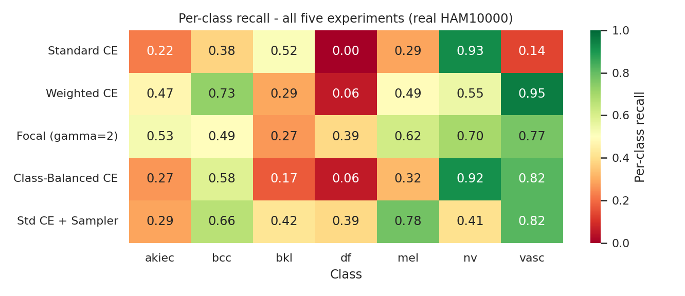
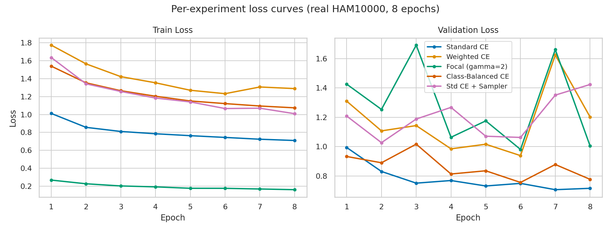
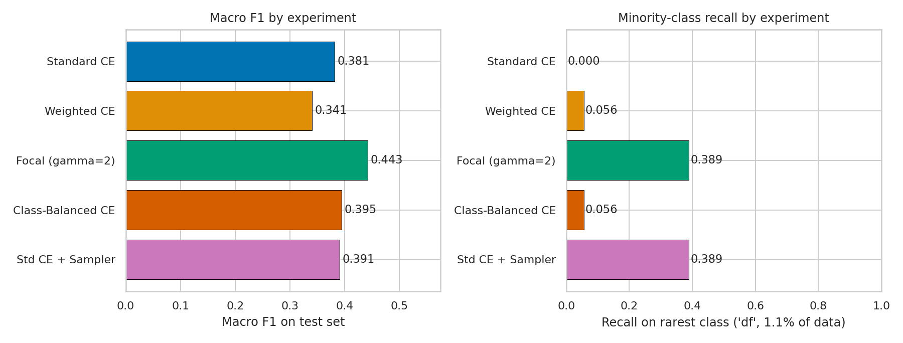

# Loss functions and sampling for imbalanced skin-lesion classification (HAM10000)

**Ömer Kahyaoğlu** · Mathematical Engineering, İstanbul Teknik Üniversitesi · kahyaoglu20@itu.edu.tr
Term project of **MYZ 309E — Artificial Intelligence in Mathematical Engineering** (Spring 2026)

[Report (PDF)](report/MYZ309E_HAM10000_Report.pdf) ·
[Slides (PDF)](slides/MYZ309E_HAM10000_Slides.pdf) ·
[Notebook](notebook/MYZ309E_HAM10000_Project.ipynb) ·
[Interactive brief](https://kahyaoglu20.github.io/projects/ham10000/brief.html) ·
[Portfolio](https://kahyaoglu20.github.io)

On HAM10000 (10 015 dermoscopic images, seven diagnoses) the majority class *melanocytic
nevi* is 67 % of the data and *dermatofibroma* only 1.1 %. A network trained with plain
cross-entropy reaches high accuracy by mostly predicting the majority class and misses the
rare, clinically important ones. This project holds the architecture, optimiser, split and
seed fixed and changes only the **loss function or the sampling strategy**, then reads the
outcome through metrics that an imbalanced clinical task actually needs: macro-F1, balanced
accuracy and per-class recall.



## Results (held-out test set, 1 503 images)

| Configuration | Macro-F1 | Balanced acc. | Accuracy | Recall *mel* | Recall *df* |
|---|---:|---:|---:|---:|---:|
| Standard CE | 0.381 | 0.352 | 0.736 | 0.29 | 0.00 |
| Weighted CE (inverse frequency) | 0.341 | 0.505 | 0.521 | 0.49 | 0.06 |
| **Focal loss (γ = 2, α = inverse frequency)** | **0.443** | **0.538** | 0.622 | 0.62 | 0.39 |
| Class-balanced CE (effective number, β = 0.999) | 0.395 | 0.447 | 0.718 | 0.32 | 0.06 |
| Standard CE + weighted random sampler | 0.391 | 0.537 | 0.464 | 0.78 | 0.39 |

Numbers are read from [`results/all_real.json`](results/all_real.json).

* **Accuracy is the wrong target.** The configuration with the best accuracy (standard CE,
  73.6 %) has the worst balanced accuracy and never detects dermatofibroma.
* **Focal loss gives the best macro-F1** (0.443 vs 0.381) and raises melanoma recall from
  0.29 to 0.62 while keeping majority-class precision high (0.92 on *nv*).
* **Re-sampling buys recall at a price.** The sampler reaches the highest melanoma recall
  (0.78), but accuracy drops to 46 %: the minority classes are now over-predicted.

## Method

| | |
|---|---|
| Data | HAM10000 from the official Harvard Dataverse archives; stratified 70 / 15 / 15 split (7 010 / 1 502 / 1 503) |
| Input | resized RGB images, ImageNet mean/std normalisation, horizontal/vertical flips for training |
| Model | four Conv–BatchNorm–ReLU–MaxPool blocks, global average pooling, dropout, two FC layers; 106 391 parameters, trained from scratch |
| Training | Adam, learning rate 10⁻³, batch 96, identical seed for every configuration |
| Losses | CE; CE with inverse-frequency weights; focal loss $-\alpha_y(1-p_y)^\gamma\log p_y$; class-balanced CE with weights $(1-\beta)/(1-\beta^{n_c})$; CE with a class-balanced `WeightedRandomSampler` |
| Evaluation | accuracy, balanced accuracy, macro precision / recall / F1, per-class recall, confusion matrices, error analysis |

The report derives each loss, explains why it changes the gradient seen by rare classes, and
discusses the over-fitting visible in the validation curves.

<p align="center">


</p>

## Repository

```
notebook/   MYZ309E_HAM10000_Project.ipynb   the end-to-end notebook (data, model, training, evaluation, figures)
src/        preprocess.py   build an image cache from the two Dataverse zips
            train_real.py   train one configuration:  python src/train_real.py "Focal (gamma=2)" 8
            train_step.py   resumable training in short steps
            plot_real.py    every figure from results/all_real.json
results/    all_real.json   histories, predictions and metrics of the five runs
figures/    the figures used in the report and slides
report/     LaTeX source and PDF of the report
slides/     presentation (PDF and PPTX)
html/       interactive briefs (a polished summary and an extended version)
```

## Reproducing

```bash
pip install -r requirements.txt
```

Download `HAM10000_images_part_1.zip`, `HAM10000_images_part_2.zip` and `HAM10000_metadata`
from the [Harvard Dataverse](https://doi.org/10.7910/DVN/DBW86T) and point the `DATA` and
`CACHE` paths at the top of `src/preprocess.py` and `src/train_real.py` to them (the paths in
the files are those of the environment the runs were made in). Then run the notebook, or
`src/preprocess.py` followed by `src/train_real.py` for each configuration and
`src/plot_real.py`.

The dataset is **not** included. HAM10000 is distributed under CC BY-NC 4.0; cite
Tschandl, Rosendahl and Kittler, *Scientific Data* 5, 180161 (2018).

## Licence

Code: MIT ([`LICENSE`](LICENSE)). Report, slides and figures: © Ömer Kahyaoğlu, shared for
reference. This is a course project and not a medical device; it must not be used for
diagnosis.
